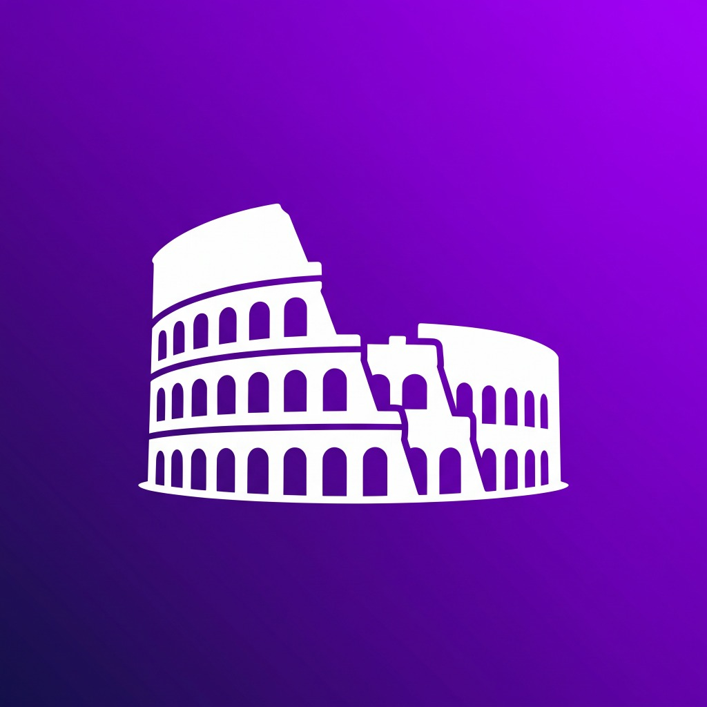

<p align="center">
  
</p>

<h1 align="center">Melodeus (Experimento Orquestado Con IA para DJs)</h1>

<p align="center">
  <strong>Estación de trabajo DJ Experimento Orquestado Con IA para Windows 10/11 de latencia ultra-baja y renderizado a 144 Hz en DirectX 12.</strong>
</p>

<p align="center">
  
  
  
  
  
  
</p>

<p align="center">
  
  
  
  
</p>

---

## 🎧 Visión General

**Melodeus** es una estación de trabajo para DJ moderna y de alto rendimiento concebida desde cero en **C++20 monolítico** y **DirectX 12 nativo**. Combina un motor de audio de tiempo real estricto con presupuesto de latencia medible (<5 ms), renderizado de formas de onda fluido a 144 Hz, integración de streaming en línea con YouTube y SoundCloud, y una interfaz de usuario DJ simétrica diseñada bajo principios de ergonomía profesional.

---

## ✨ Características Principales

### 🚀 Renderizado a 144 Hz en DirectX 12
- Pipeline de formas de onda acelerado por hardware con shaders HLSL (`waveform.vso` / `waveform.pso`).
- Pirámides multinivel con dos carriles sincronizados por deck: **Overview** (visión global de la pista) y **Detalle dinámico** (ventana deslizante de ±6 s a 144 Hz sostenidos).
- Indicadores en tiempo real de beat grid, marcadores de loop y hot cues adaptativos.
- Splash Screen cinemático de bienvenida con desvanecimiento suave (*fade-out*).

### ⚡ Motor de Audio de Latencia Ultra-Baja (<5 ms)
- Salida mediante **WASAPI Exclusivo**, **WASAPI Compartido de baja latencia (`IAudioClient3`)** y **ASIO** a través de módulos headless de JUCE.
- **Garantías de tiempo real estrictas**: Cero llamadas a `malloc`/`new` en el callback de audio, comunicación inter-hilos sin bloqueos mediante anillos **SPSC lock-free**.
- Algoritmo elástico **Master Tempo (Pitch Lock)** y Key Shifting para mantener la afinación musical independiente de la velocidad.

### 🎛️ Consola DJ Simétrica
- **Estructura ergonómica**: `[ Deck A | Mixer Central | Deck B ]` en la sección superior y paneles de biblioteca independientes debajo de cada deck.
- **Mixer de precisión**: Crossfader simétrico con curvas DJ, faders de ganancia individual, ecualización tribanda (Low, Mid, High) y filtros bipolares Hi-Pass / Low-Pass con barrido de resonancia.
- **Hot Cues y Loops elásticos**: 3 ranuras de Hot Cues instantáneas por deck y escalera de loops de 9 longitudes (de 1/8 a 32 beats).
- **Consistencia visual glassmorphism**: Paleta adaptativa en Electric Purple, Neon Cyan y acentos configurables.

### 🌐 Streaming Directo: YouTube & SoundCloud Integrados
- Búsqueda en vivo y descarga asíncrona permanente sin congelar la interfaz mediante `yt-dlp` y `ffmpeg`.
- Búsqueda directa por prefijo o palabras clave (`scsearch` para SoundCloud, `ytsearch` para YouTube).
- Transcodificación automática a WAV flotante con sanitización de nombres en Windows e inserción automática en la biblioteca local.

### 📚 Biblioteca SQLite de Alto Rendimiento
- Motor de base de datos SQLite con indexación full-text **FTS5** (<4 ms para colecciones de más de 50,000 pistas).
- Importación recursiva de carpetas en segundo plano y compatibilidad completa con arrastrar y soltar (*Drag & Drop*) desde Windows Explorer.
- Footer de biblioteca en dos filas dedicadas con micro-keycaps y visor de estado de pista completa.

### 🌍 Internacionalización y Ayuda In-App
- Soporte multilingüe completo (100% traducido) en **Español**, **Inglés** y **Portugués (Brasil)** con conmutación en caliente.
- Guía interactiva in-app (`[ AYUDA ]` o tecla `F1`) con manual de funcionamiento y tabla de atajos.

---

## 📦 Descarga e Instalación

### Instalador Oficial para Windows
El instalador autónomo empaqueta todos los binarios, shaders, fuentes y las herramientas de streaming (`yt-dlp` y `ffmpeg`) para funcionar de inmediato en cualquier PC sin dependencias previas:

1. Dirígete a la sección de **[Releases](https://github.com/danedsant/Melodeus/releases)**.
2. Descarga el ejecutable: **`Melodeus_Setup_v1.0.exe`** (~63.5 MB).
3. Ejecuta el asistente de instalación:
   - Selecciona el idioma (Español, Inglés o Portugués).
   - Elige si deseas crear un acceso directo en el escritorio.
   - ¡Listo para pinchar! Melodeus se abrirá maximizado y listo para mezclar.

---

## ⌨️ Atajos de Teclado Predeterminados

| Tecla / Combinación | Acción | Descripción |
|---|---|---|
| `Espacio` | **Play / Pausa Deck A** | Inicia o pausa la reproducción en el Deck A |
| `Shift + Espacio` | **Play / Pausa Deck B** | Inicia o pausa la reproducción en el Deck B |
| `C` / `Shift + C` | **Cue Deck A / B** | Regresa al inicio o punto Cue establecido |
| `1` / `2` / `3` | **Hot Cues Deck A** | Dispara o asigna Hot Cues 1, 2 o 3 |
| `Q` | **Quantize Toggle** | Activa o desactiva la cuantización de eventos |
| `F1` / `[ AYUDA ]` | **Manual & Guía** | Abre o cierra la guía interactiva de Melodeus |
| `↑` / `↓` | **Navegación Biblioteca** | Sube o baja la selección de pistas |
| `Enter` | **Cargar en Deck A** | Carga la pista seleccionada en el Deck izquierdo |
| `Shift + Enter` | **Cargar en Deck B** | Carga la pista seleccionada en el Deck derecho |
| `/` | **Foco en Búsqueda** | Salta directamente a la barra de búsqueda |
| `Esc` | **Cerrar / Limpiar** | Cierra ventanas modales o limpia el buscador |

---

## 🛠️ Compilación desde Código Fuente

### Requisitos Previos
- **Sistema Operativo**: Windows 10 (versión 1809+) o Windows 11 (x64).
- **Compilador**: Microsoft Visual C++ (MSVC) con soporte C++20 (Visual Studio 2022 o Build Tools).
- **Herramienta de Construcción**: [CMake](https://cmake.org/) ≥ 3.24.
- **Windows SDK**: Windows 10/11 SDK (10.0.22000+ o superior) con `fxc.exe` para compilación de shaders.
- **Inno Setup** *(opcional, para construir el instalador)*: Inno Setup 6.

### Pasos de Construcción

1. **Clonar el repositorio**:
   ```powershell
   git clone https://github.com/danedsant/Melodeus.git
   cd Melodeus
   ```

2. **Descargar las dependencias externas**:
   ```powershell
   .\scripts\fetch_deps.ps1 -Group all
   ```

3. **Configurar el proyecto con CMake**:
   ```powershell
   cmake -B build -S . -G "Visual Studio 17 2022" -A x64
   ```

4. **Compilar en modo Release**:
   ```powershell
   cmake --build build --config Release
   ```

5. **Ejecutar pruebas unitarias**:
   ```powershell
   .\build\tests\Release\melodeus_tests.exe
   ```

6. **Ejecutar prueba de rendimiento D3D12 (Selftest a 144 Hz)**:
   ```powershell
   .\build\app\Release\Melodeus.exe --selftest 2
   ```

7. **Compilar el instalador (con Inno Setup 6)**:
   ```powershell
   & "C:\Users\danie\AppData\Local\Programs\Inno Setup 6\ISCC.exe" installer\melodeus_setup.iss
   ```

---

## 🏛️ Arquitectura del Software

```
                     ┌───────────────────────────────────┐
                     │    Hilo Principal Win32 / UI      │
                     │  ImGui Docking + D3D12 @ 144 FPS  │
                     └─────────────────┬─────────────────┘
                                       │
                      Lectura Lock-Free│ SPSC Buffer
                                       ▼
 ┌──────────────────────┐    ┌───────────────────┐    ┌──────────────────────┐
 │    Motor de Audio    │    │  Worker Streaming │    │  Worker Biblioteca   │
 │   Callback en RT     │◄───┤  yt-dlp + ffmpeg  │    │      SQLite FTS5     │
 │  WASAPI / ASIO <5ms  │    │  Caché LRU Disco  │    │ Importación en hilo  │
 └──────────────────────┘    └───────────────────┘    └──────────────────────┘
```

- **Separación de Hilos**: El hilo de audio en tiempo real tiene prioridad `Pro Audio` mediante `AvSetMmThreadCharacteristics` y jamás bloquea por IO de disco o asignaciones dinámicas.
- **Waveform Pass**: Dibujo instanciado en DirectX 12 mediante búferes de vértices rotativos por ranura de fotograma (`frame_slot`).

---

## 📊 Métricas de Desarrollo

- **Orquestación**: danedsant
- **Plataformas de Ingeniería**: Antigravity & OpenCode
- **Modelos de Inteligencia Artificial**: `Gemini 3.8 Flash High y MiMo V2 Flash Free`
- **Cómputo Cognitivo**: `~14.5M tokens procesados` abarcando DSP de audio, shaders HLSL, interfaz Win32/ImGui, transcodificación streaming y sistema de empaquetado.

---

## 📄 Licencias y Créditos de Terceros

Melodeus se distribuye bajo términos de software abierto, integrando componentes y librerías de clase mundial:

- **Dear ImGui** (v1.91.x) — [Licencia MIT](https://github.com/ocornut/imgui) · Omar Cornut.
- **JUCE Framework** (Módulos de audio y dispositivos) — [Licencia ISC / Permisiva](https://juce.com/) · Raw Material Software.
- **SQLite** (v3.46.x) — [Dominio Público](https://www.sqlite.org/).
- **Microsoft ONNX Runtime** — [Licencia MIT](https://github.com/microsoft/onnxruntime) · Microsoft Corp.
- **yt-dlp** — [The Unlicense](https://github.com/yt-dlp/yt-dlp) · Dominio Público.
- **FFmpeg** — [LGPL v2.1+ / GPL v3](https://ffmpeg.org/) · The FFmpeg developers.
- **Inno Setup** — [Inno Setup License](https://jrsoftware.org/isinfo.php) · Jordan Russell / Martijn Laan.
- **Inter Font** — [SIL Open Font License 1.1](https://rsms.me/inter/) · Rasmus Andersson.
- **JetBrains Mono** — [SIL Open Font License 1.1](https://www.jetbrains.com/lp/mono/) · JetBrains s.r.o.
- **Phosphor Icons** — [Licencia MIT](https://phosphoricons.com/) · Phosphor Icons.

---

<p align="center">
  Elaborado como experimento para explorar las capacidades de la Inteligencia Artificial para DJs y productores que exigen rendimiento extremo, estabilidad absoluta y latencia cero.
</p>
